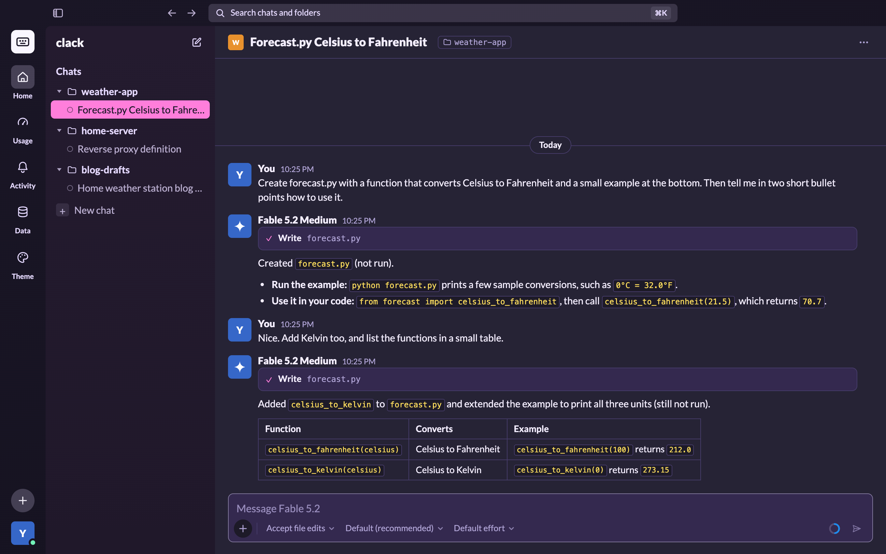
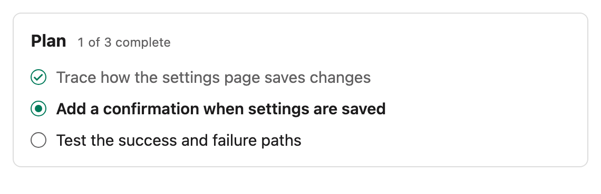
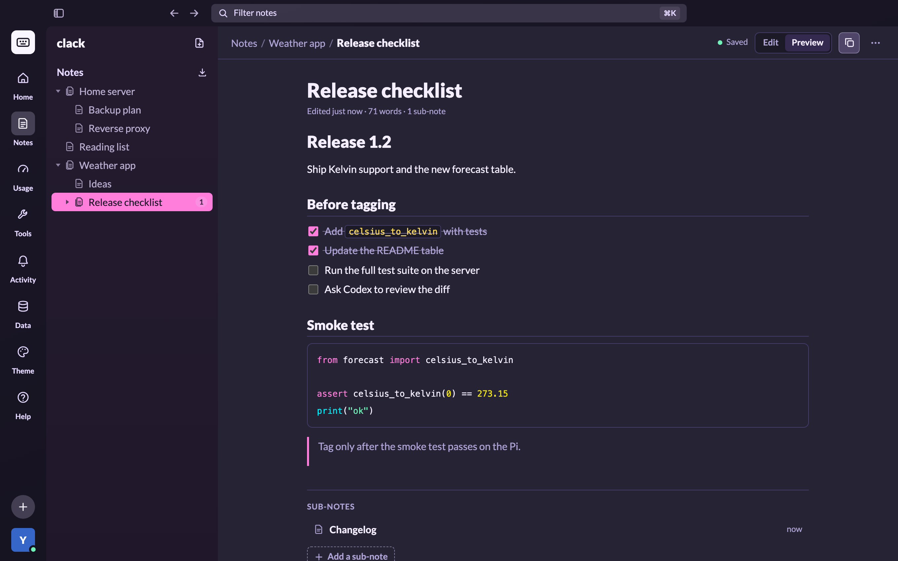
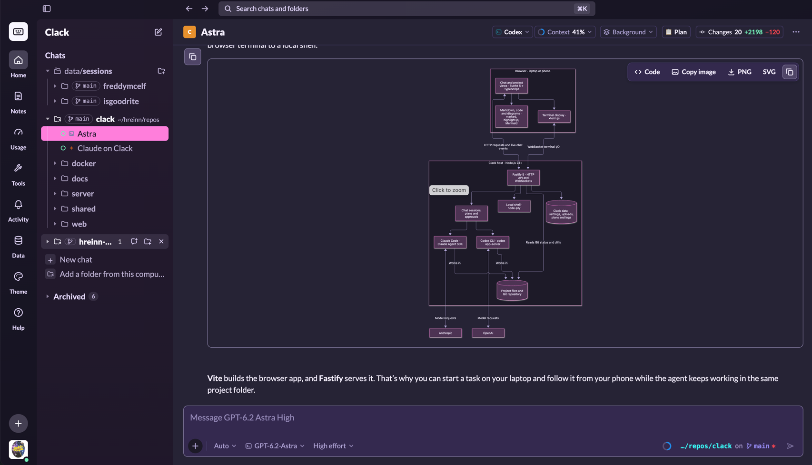
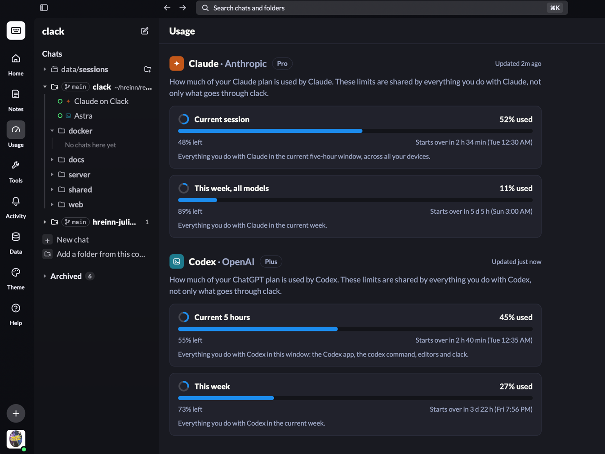

# Clack

Clack is a self-hosted workspace for Claude Code and Codex. Work on the same project
from your browser, phone or desktop app while the agents run on your server.



## Features at a glance

- Ask Claude to sketch an approach, then hand the same chat to Codex. [Agents and switching](docs/agents.md)
- Group chats by project, attach screenshots and review Git diffs file by file. [Chats and folders](docs/chats.md)
- Follow a live plan from your phone, answer questions and approve the next step. [Plans and progress](docs/chats.md#context-background-work-plans-and-changes)
- Set several chats going and see which are working, which need you and which have a reply to read. [The Active list](docs/chats.md#the-active-list)
- Keep Markdown notes beside your chats and export them individually or together. [Notes](docs/notes.md)
- Zoom into Mermaid diagrams in replies and save them as PNG or SVG. [Diagrams](docs/diagrams.md)
- Check usage limits, inspect available tools and review the activity log. [Usage and tools](docs/usage-and-tools.md)
- Browse files, open a server terminal and choose your theme. [Interface](docs/interface.md)
- Connect to an existing server or start one from a native window. [Desktop app](docs/desktop.md)

<table>
  <tr>
    <td width="50%"><a href="docs/chats.md#context-background-work-plans-and-changes"></a><br><sub><b>Plans</b>: follow the agent's checklist as it works.</sub></td>
    <td width="50%"><a href="docs/notes.md"></a><br><sub><b>Notes</b>: markdown notes in a tree, next to your chats.</sub></td>
  </tr>
  <tr>
    <td width="50%"><a href="docs/diagrams.md"></a><br><sub><b>Diagrams</b>: Mermaid drawn in the reply, click to zoom.</sub></td>
    <td width="50%"><a href="docs/usage-and-tools.md#usage"></a><br><sub><b>Usage</b>: both agents' plan limits at a glance.</sub></td>
  </tr>
</table>

## Requirements

| | From source | Desktop app | Docker |
| --- | :---: | :---: | :---: |
| [Node.js](https://nodejs.org) 24 or newer | ✓ | to build the app or start a local server | — |
| Claude Code and/or Codex, signed in | on the server | on the server you connect to | inside the container |
| [Rust](https://rustup.rs) (and WebKitGTK on Linux) | — | to build it | — |
| [Docker](https://docs.docker.com/get-docker/) with Compose 2.24+ | — | — | ✓ |

**The agents.** One is enough; with both, a chat can use either and move between them.

- **Claude Code** needs a Claude subscription (Pro or Max) or an Anthropic API key. It
  comes with Clack (through the Agent SDK); sign it in once with `claude auth login`.
- **Codex** needs a ChatGPT plan (Plus or higher) or an OpenAI API key, and the `codex`
  command: `brew install codex` or `npm install -g @openai/codex`, then `codex login`.

See [Claude and Codex](docs/agents.md) for API keys, signing in on a server without a
browser, and how the two work together.

## Install and run

```bash
git clone https://github.com/hreinn91/clack.git
cd clack
npm install
npm run build
npm start
```

The server prints its addresses and an access token. Open the address in a browser (the
"Local network" one from your phone or another computer) and enter the token once; the
browser stays signed in after that.

- Run `node -v` in the shell that starts Clack to check it is Node 24 or newer: the
  build can succeed on an older version, but the server will not start.
- On Linux, `npm install` compiles the terminal support and needs a C++ toolchain
  (`build-essential` and `python3` on Debian and Ubuntu).
- Settings such as the port, the data directory and the token go in `.env`; see
  [Configuration](docs/configuration.md). Everything has a default.
- To update, `git pull`, then `npm install`, `npm run build` and start it again.

## Desktop app

The desktop app is a native window onto a Clack server: the same app as in the browser,
which keeps working beside it. When it opens it connects to `http://localhost:4317`
(or the server you used last), and if nothing answers it offers to connect elsewhere or
to **Start Clack** on this computer, from your Clack folder with your Node.js. A server
it started stops when the app quits.

Build it after the steps above, with [Rust](https://rustup.rs) installed (on Linux,
also Tauri's [prerequisites](https://tauri.app/start/prerequisites/)):

```bash
cd desktop && npm install && cd ..
npm run desktop          # run it from source
npm run desktop:build    # build the app for this computer
```

The app lands in `desktop/src-tauri/target/release/bundle/`: `Clack.app` and a `.dmg` on
a Mac, `.msi` and `.exe` on Windows, `.deb`, `.rpm` and `.AppImage` on Linux. On a Mac,
`open desktop/src-tauri/target/release/bundle/macos/Clack.app` runs it, and copying it
to `/Applications` installs it. The **Desktop app** workflow in `.github/workflows`
builds all three platforms on GitHub. See [Desktop app](docs/desktop.md) for the details.

## Docker

With Docker and Docker Compose (2.24 or newer) nothing else needs installing:

```bash
docker compose up -d
```

The first run builds the image, which takes a few minutes. (Homebrew installs Compose as
`docker-compose`; if `docker compose` is not found, use `docker-compose` instead.) Then:

1. **Get the access token.** It is printed when the container starts:

   ```bash
   docker compose logs clack
   ```

2. **Sign Claude Code in**, once. It asks you to open a link and paste a code back:

   ```bash
   docker compose exec clack claude auth login
   ```

   Or run `claude setup-token` on any computer and put the token it prints in `.env` as
   `CLAUDE_CODE_OAUTH_TOKEN`, then `docker compose up -d` again.

3. **Sign Codex in**, if you want it as well. The image includes it:

   ```bash
   docker compose exec clack codex login --device-auth
   ```

   Device code sign-in has to be allowed in your ChatGPT account's security settings.
   Or put an OpenAI API key in `.env` as `CODEX_API_KEY`. Without either, Clack runs
   without Codex.

4. **Open** `http://localhost:4317`, or the host's address from another device.

The data directory is `./data` on the host; the agents' sign-ins and conversations are
in the `clack-home` volume. After changing `.env`, run `docker compose up -d` again; after
updating the code, `docker compose up -d --build`. See [Docker](docs/docker.md) for what
lives where, the settings, what the image holds, and using your SSH keys in it.

## Documentation

| Page | What is in it |
| --- | --- |
| [The interface](docs/interface.md) | The window and sidebar, the Data page with its file tree and terminals, and the themes |
| [Chats and folders](docs/chats.md) | Where chats work, managing chats and folders, model and effort, context, background work, plans, reviewing changes, attachments |
| [Claude and Codex](docs/agents.md) | Signing in, how the two agents work side by side, switching a chat between them |
| [Notes](docs/notes.md) | The notes tree, writing and preview, export |
| [Diagrams](docs/diagrams.md) | Mermaid diagrams in replies and notes, the viewer, and the diagram skill |
| [Usage, tools and the activity log](docs/usage-and-tools.md) | Plan limits, MCP servers and skills, and the log of everything that happened |
| [Desktop app](docs/desktop.md) | The desktop app in full, and building it |
| [Docker](docs/docker.md) | What lives where, settings, the image, SSH keys |
| [Configuration](docs/configuration.md) | Every setting in `.env` |
| [Security](docs/security.md) | What the folder limit covers and what it does not, terminals, the network and the token |
| [Development](docs/development.md) | Running from source with hot reload, checks and tests, and the code layout |

## Security at a glance

Clack lets whoever signs in have an agent run commands on the server computer as you.
Read [Security](docs/security.md) before sharing it, but in short:

- **Folder limits vary by agent.** Claude checks file paths and Codex uses its sandbox.
  A signed-in user can approve commands and add project folders.
- **Terminals** on the Data page are shells on the server as your user; set
  `CLACK_TERMINAL=off` to remove them.
- **The connection is plain HTTP.** Keep Clack on a network you trust and never forward
  its port to the internet. For SSH tunnelling, bind the source server to
  `127.0.0.1` or restrict the published port in [Docker Compose](docs/docker.md#settings).
- **The access token** grants access to every chat. To sign all browsers out, change
  `CLACK_TOKEN` or delete the generated `~/.config/clack/token` file, then restart.
- **Prompts and replies are logged** in plain text in `data/logs`, and unsent messages
  are kept in `data/drafts.json`.

## Development

```bash
npm run dev      # the server with auto-restart and Vite with hot reload (port 5173)
npm run check    # type checks
npm test         # the server's tests
```

See [Development](docs/development.md) for the code layout.
