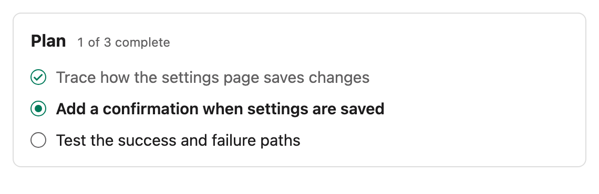

# Chats and folders

[← README](../README.md) · [All docs](../README.md#documentation)

Where chats work, how to organise them, the model and effort, attachments, and what
a chat shows while the agent works: its context, background work, plans and changes.

## Where chats work

On first start the server creates a `data` directory next to the code. It is not checked in.

```
data/
  sessions/
    new-chat-session/     one folder per project; Claude Code runs with this as its working directory
    work/
      client-a/           folders can be nested; a chat can work in any of them
  logs/
    clack-2026-11-14.jsonl  the activity log, one file per day
  preferences.json        the model and effort chosen for each chat
  roots.json              the folders outside data/sessions that were added
  chats.json              chats that ran on Codex or switched agent: which conversations each is made of
  avatar.webp             your picture, if you uploaded one (or avatar.png / avatar.jpg)
  drafts.json             what was typed in each chat's message box and not sent yet
  notes/
    Project ideas.md      a note
    Project ideas/        the notes inside it
      Clack notes.md
```

The **New chat** page asks where the chat should work, with three choices:

- **New folder** (the default): pick where it goes (the top level, or inside one of your
  folders) and type a name. A preview shows the folder tree with the new folder marked
  **New**, and the button says **Create folder and start chat**. A new folder's name is reduced to
  lowercase letters, digits and dashes; a name with slashes, such as `work/client-a`,
  makes nested folders (up to eight deep). Leaving the name empty makes one up, such as
  `chat-20261117-203112`. If the folder is already there, the preview says so and the
  chat joins it.
- **Existing folder:** the same fuzzy search as **Change folder**, over every folder
  under `data/sessions`. With nothing typed it lists your top-level folders and the
  folders that have chats, with how many chats each has. Pick one to start. Folders you
  made yourself keep their names as they are (`MyRepo`, `my_project`, `site.com`).
- **On this computer:** any folder outside `data/sessions`, such as a project you already
  have. Walk the folders from your home folder (click a folder to go in, the arrow to go up,
  the house for home), click a part of the path above the list, or type or paste a path
  (`~/code/site`) and press Enter. Folders that are git repositories have a branch icon.
  The folder you are in is the one picked: **Add folder and start chat** adds it and starts
  a chat there, and **Add to sidebar** only adds it. The picker remembers where you were.
  The **Add a folder from this computer** link under the chats tree opens it too.

An added folder gets its own tree in the sidebar, below `data/sessions`, and chats can work
in it and in any folder inside it. Claude is kept inside the chat's folder the same way as
under `data/sessions`. A folder inside one already added just uses that one; a folder that
holds folders added earlier takes their place. Picking a symlink adds the folder it points
to. Clack's own data directory cannot be added, and when an added folder holds it (Clack's
own code, say) it is left out of that folder's tree.

Claude Code lists sessions by the folder they ran in, so chats you had in an added folder
from the `claude` command line show up in its tree too, and can be carried on in Clack.

There is no way to start or resume a chat anywhere else from the UI, and Claude Code
sessions from other folders on the computer are not listed. With `CLACK_OUTSIDE_FOLDERS=off`
in `.env`, folders cannot be added (or browsed) at all, and chats stay in `data/sessions`.

In Docker the picker shows the container's folders, not the host's. To work on a project
on the host, mount it into the container in `docker-compose.yml` (under `volumes`) and add
it from there.

See [Security](security.md) for what this limit does and does not guarantee.

## Managing chats

The sidebar shows every folder under `data/sessions` as a tree, at any depth. The tree
starts at `data/sessions` itself, with thin lines showing what is inside what, since
every chat works in a folder in there. Hidden folders (such as `.git`) and
`node_modules` are left out, and so are files: those are on the
[data page](interface.md#data-page).

- A folder that chats work in has a filled green icon and the number of its chats. A
  folder with no chats anywhere inside it is dimmed. A folded folder with chats further
  down shows how many.
- A folder that is the top of a git repository (it has a `.git` of its own) has a small
  branch badge, between the folder icon and the name, with the branch it is on, or the
  start of the commit's hash when it is detached. While the row's buttons are showing only
  the icon stays, so the name has room.
- **Added folders** (from **On this computer**) each have a tree below `data/sessions`,
  shown by their name with the path after it, dimmed. Hover the row for a new chat in the
  folder itself, a new folder inside it, and **×** to remove it from Clack, after asking.
  Removing only takes it off the list: nothing in it is deleted, and its chats leave the
  sidebar until it is added again. The folders inside it can be deleted like any other.
  A folder that is no longer there is struck through.
- Folders with chats come first, the most recently used at the top; the rest follow by
  name. Folders with chats start unfolded, the rest folded. Click a folder's name to fold
  or unfold it; the browser remembers it.
- **New chat in a folder:** hover the folder (on a touch screen the buttons are always
  there) and click the speech-bubble button. The chat starts there straight away.
- **New folder:** the folder button on the `data/sessions` row makes one at the top
  level, and the same button on a folder's row makes one inside it. Type the name and press Enter, or
  Escape to cancel.
- **Delete a folder:** the bin button on a folder's row deletes it, with every file and
  folder inside it, after asking. This cannot be undone. Not while a chat working in it is
  busy. Chats that worked there are kept and move to **Archived**, marked **deleted**
  (see below).

- **Rename:** click the title at the top of a chat, or use **Rename…** in a chat's
  **⋯** menu (in the sidebar row, or at the top right of the chat).
- **Change folder:** click the folder in the message box, or **Change folder…** in the
  menu. A search box finds any folder under `data/sessions`, fuzzy like fzf: the letters
  you type must appear in order, gaps allowed, so `wca` finds `work/client-a`; spaces
  separate words that must all match. Pick with the arrow keys and Enter, or click. A
  name that is not a folder yet is offered as **Create**. Claude works there from the
  next message and keeps the conversation so far. No files are moved: what the chat made or was given earlier stays in the old
  folder, and pictures attached before the move are shown by name only.
- **Archive:** puts a chat in the **Archived** section, folded shut at the bottom of the
  sidebar. Take it out again from its menu; sending a message in it does the same.
- **Deleted folders:** a chat whose folder no longer exists counts as archived. It is
  listed in **Archived**, marked **deleted**, and can still be read. To carry on with it,
  use **Recreate folder** (an empty folder with the old name) or **Change folder…**,
  from its menu or from the bar above the message box. Either one puts it back in the
  tree.
- **Delete:** removes the conversation for good, after asking. The files in its folder
  stay.

**Quick switcher:** Cmd+K (Ctrl+K on Windows and Linux), or the button in the search
field, opens a box for jumping around. Type part of a chat's name or folder and press
Enter to open it. Typing a folder name also offers to start a new chat there, creating
the folder if it is new. The pages (Usage, Activity, Data, Theme) are listed too.

Changing a chat's folder moves the conversation's file inside Claude Code's own storage
(`~/.claude/projects`), which is not a public interface of Claude Code, so a future
version of Claude Code could break it.

## Model and effort

The message box has a model menu and an effort menu, next to the one for the permission
mode. Each opens as a list of every choice, with a line saying what it is for. The model menu groups available models by agent. A choice applies from the
next message, is remembered for that chat, and becomes the starting point for new chats.
"Default" leaves the choice to the selected agent.

## Context, background work, plans and changes

**Context** beside the title at the top of a chat shows how full that chat's context
window is. Clicking it opens what Claude Code's `/context` shows: the percentage and
token count, where automatic compacting starts, and what takes up the room (the
conversation, the system prompt, tools, CLAUDE.md files, skills, MCP servers, agents),
as a bar and as a list with the figures. Tool definitions that are only loaded when
needed are mentioned but not counted. Each opening measures again; the round arrow does
too. If the chat has no Claude Code process at that moment, one is started to count,
which takes a few seconds, and it stops again after the usual idle time.

**Background** beside it lists what Claude left running in that chat while it carries
on: shell commands started in the background and agents it handed work to, as in Claude
Code's own background tasks. While something runs, the chip shows how many, with a
pulsing dot. Each entry says what it is, how long it has been going, how many tools an
agent has used and which one last, and has a **Stop** button. Finished ones stay
listed below, with whether they were done, failed or stopped, and how long they took.
A chat with background work still going is not shut down when it sits idle, since that
would end the work. When a background agent is done, the chat says so in a short note,
and Claude usually replies to what it found.

For example, ask *“Add a confirmation when my settings are saved. Test what happens
if saving fails.”* When Claude or Codex reports a plan, its steps appear in the conversation and update
as the agent works. In Plan mode, the proposed plan appears as Markdown. Select
**Plan** in the chat header to read the latest proposal or checklist, then **Back
to chat** to return to your place. Earlier plans stay in the transcript.



**Changes** beside those controls appears when the chat's folder is inside a Git repository under `data/sessions`
or within a project folder added to Clack. With everything committed it reads **No changes** and does
nothing. With uncommitted changes it shows how many files and how many lines were
added and removed, and the branch in the message box gets a `*`. Clicking **Changes**
opens a review with the changed files in the left sidebar, grouped by Git status
(in conflict, staged, not staged and untracked).
Each file has git's letter for the change (M modified, A added, D deleted, R renamed,
U untracked) and its lines added and removed; a new file counts all its lines as
added. The list also says how many commits are not pushed or still to pull. The counts
are taken again when the chat is opened, shortly after each tool Claude runs, when a
reply ends, each time the list is opened, and every 20 seconds while the chat is open
(so a commit made in a terminal shows up too). Clack asks git with the settings that
would run other programs (filesystem monitors, external diff tools) switched off.

Select a file to read its diff in the conversation area. On desktop, the first file opens
automatically. Use the search field above the list to filter by path, or use the arrows in
the diff to step through the files. On a phone, the list opens first. Tap a file to read
its diff, then **Changed files** to return to the list.

The diff shows removed and added lines with their old and new line numbers and the
theme’s code colours. **Changes** shows a few lines around each edit. Click a gap or
choose **Whole file** for more context. New files show every line as added. For files
in conflict, the diff highlights Git’s conflict markers. Binary files and files over
1 MB show a notice. **Back to chat** returns to the conversation with your draft
and reading position preserved.

## Attaching files

The **+** at the left of the message box attaches files to the next message: pictures,
text documents, or anything else Claude should look at. Dropping files on the message
box or pasting a copied picture does the same. Each file is shown above the message
until you send it, and can be taken off again with its ×.

Attachments are saved under `data/uploads/<chat-id>/`, with a limit of 25 MB per file.
The message includes the file's path for the agent to read. Duplicate names get a number
added, and removing an attachment from a draft leaves the saved file on disk.
In the conversation, attached pictures are shown as pictures and other
files by name; clicking one opens it on the [data page](interface.md#data-page).
