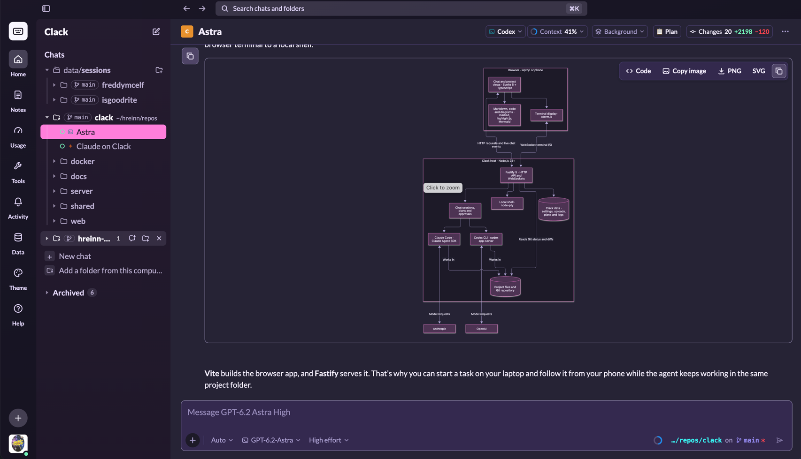
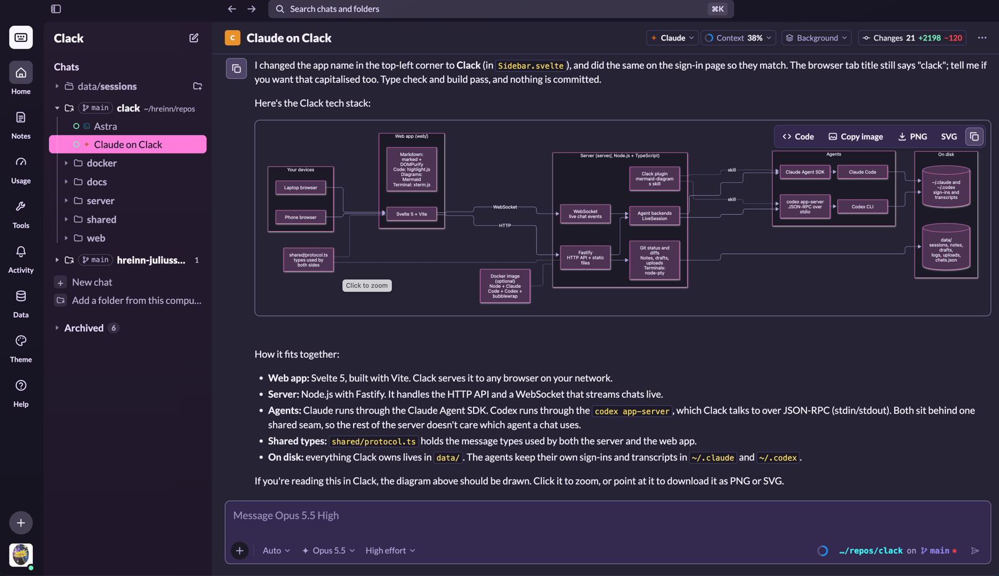

# Diagrams

[← README](../README.md) · [All docs](../README.md#documentation)

Replies can hold diagrams. A ` ```mermaid ` code block in a reply is drawn as a
[Mermaid](https://mermaid.js.org) diagram, in place between the text: flowcharts,
sequence diagrams, state machines, ER and class diagrams, Gantt charts, timelines, pie
charts, mind maps and the rest. Ask for one ("draw how a request flows through this
app") and the agent writes it.



- **In the theme's colours.** Diagrams take their colours from the theme and are drawn
  again when it changes.
- **Click to zoom.** A diagram opens over the whole window, fitted to it. Scroll or
  pinch to zoom, drag to move, double-click to switch between fitted and actual size,
  and Esc (or a click beside it) closes it.
- **Point at a diagram** for its tools: **Code** shows the Mermaid code under it, the
  copy button copies that code, **PNG** and **SVG** download it as a picture (on the
  theme's background). **Copy image** puts the picture on the clipboard, but only where
  the browser allows that: on `http://localhost` or over HTTPS, not on a plain `http://`
  address on the local network. On a phone the tools are always shown, and in the
  zoomed view a long press offers the phone's own Copy and Save.
- **While a reply is being written** a diagram waits as a placeholder until the reply is
  finished, rather than redrawing half-written code.
- **When the code has a mistake**, the code is shown with Mermaid's error instead.
- **Notes** draw ` ```mermaid ` blocks the same way in the preview.

Mermaid is bundled with Clack and the browser only fetches it from the Clack server the
first time a diagram is shown. It runs in its strict mode: no scripts, no click actions,
and the drawing is sanitized before it is shown.

**The diagram skill.** Clack hands both agents a skill of its own,
`clack:mermaid-diagrams`, which tells them diagrams are drawn here, which diagram type
suits what, and the syntax mistakes that stop Mermaid. The agent loads it when you ask
for a diagram or a chart; it does not change the agent's instructions otherwise. It
lives in `server/plugin` and is passed to Claude Code as a plugin and to Codex as an
extra skills folder, so nothing is written to `~/.claude`, `~/.codex` or the chat's
folder. It is listed on the [Tools page](usage-and-tools.md#tools-and-skills) with the other skills.



