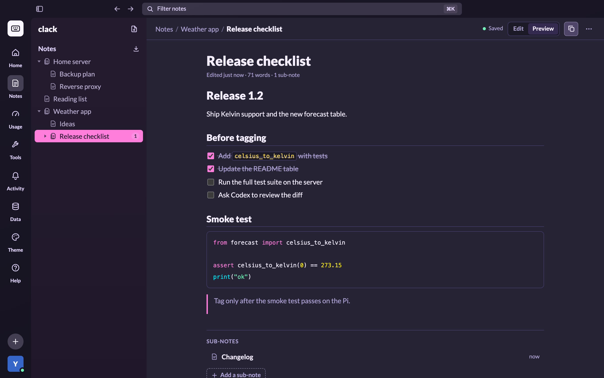

# Notes

[← README](../README.md) · [All docs](../README.md#documentation)

**Notes** in the rail is a place to write things down next to your chats: plans,
checklists, snippets, things to tell the agent later. Notes are markdown, and they
are kept on the server as plain `.md` files in `data/notes`, so you can read and edit
them outside Clack too.

- **A tree, like the chats.** The sidebar lists your notes. A note can hold other notes,
  as deep as you like: **+** on a note's row (or **Add a sub-note** at the bottom of the
  note) makes one inside it, and the arrow folds them away. The new-note button at the
  top of the sidebar makes one at the top level. Drag a note onto another to put it
  inside, or onto the **Notes** heading to bring it back to the top. The search field
  narrows the tree by name, and Cmd+K finds notes by name too.
- **Naming.** A new note opens with its title selected: type a name and press Enter to
  start writing. Rename a note from its title, by double-clicking it in the sidebar, or
  from its **⋯** menu. Characters a file name cannot hold (such as `/` or `:`) become
  `-`, and a name that is taken gets a number, as in **Plan 2**.
- **Writing.** Notes save themselves a moment after you stop typing, and the bar says
  **Saving…** or **Saved**; Cmd+S saves straight away. **Edit** and **Preview** switch
  between the markdown and how it reads (Cmd+E switches too, and the choice is
  remembered). In the editor, Enter carries a list on (`-`, `1.`, `- [ ]`) and ends it
  on an empty item, Tab and Shift+Tab indent list items, and Cmd+B and Cmd+I make the
  selection bold or italic. In the preview, code is coloured in the theme's code
  colours, and task boxes can be ticked, which ticks them in the text.
- **Copy and export.** The copy button copies the note's markdown. The **⋯** menu
  (on the note and on its row in the sidebar) has **Export as Markdown** for the note's
  `.md` file and, for a note with notes inside it, **Export with sub-notes (.zip)**,
  which keeps the tree as folders. The download button beside the **Notes** heading
  exports every note as one `.zip`.
- **Moving and deleting.** **Move to…** in the **⋯** menu picks a new place from a list.
  **Delete…** asks first, says how many notes inside it go too, and offers an export
  before they do. A deleted note cannot be brought back.
- **More than one browser.** A note saved in another browser shows up in this one
  straight away. If you were typing here at the same time, a bar asks whether to keep
  your version or use the other one, so neither is lost without asking.

A folder in `data/notes` with no `.md` beside it is shown as an empty note, so notes
dropped into the folder by hand appear too. Files that are not `.md`, hidden files and
symlinks are left out.
