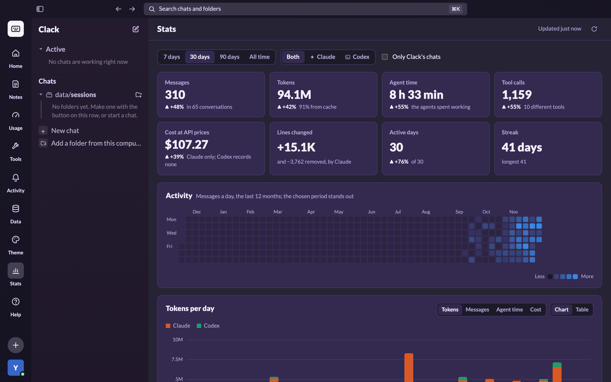

# Stats

[← README](../README.md) · [All docs](../README.md#documentation)

**Stats** in the rail shows how you have used Claude and Codex over time: how much,
when, with which models, in which projects and with which tools. Where
[Usage](usage-and-tools.md#usage) shows your plan's limits right now (like `/usage`),
Stats is the history, in the spirit of Claude Code's `/stats`.

## What it shows

- **Tiles:** messages sent, tokens (and how much came from the cache), the time the
  agents spent working, tool calls, cost at API prices, lines changed, active days and
  your streak of days in a row. For 7, 30 and 90 days each tile also says how it
  changed from the period before.
- **Activity:** a calendar of the last 12 months, a square a day, darker the more
  messages were sent. The chosen period stands out.
- **Per day:** tokens (by agent), messages, agent time or cost, as a chart or a table.
  Long periods are summed by week.
- **Models:** tokens and cost by model, each marked with its agent.
- **When you work:** messages by weekday and hour, and your busiest hour.
- **Where the tokens went:** cache reads, cache writes, input and output, and how much
  of what the agents read came from the cache.
- **Tools:** the most used tools, and how permission cards were answered in Clack.
- **Projects:** each folder with its conversations, messages, tokens, agent time and
  cost. Click one to see the whole page for that project only.
- **Heaviest conversations:** the ten that used the most tokens. Clack's own chats link
  to the chat.
- **Replies in Clack:** how many replies Clack's chats had, how long they took on
  average, and how many were stopped or failed.

Hover over the charts for exact figures, or focus them and use the arrow keys.

## Filters

One row at the top scopes the whole page: **7 days**, **30 days**, **90 days** or
**All time**; **Both** agents, **Claude** or **Codex**; and **Only Clack's chats**,
which leaves out what you did with the `claude` and `codex` commands and apps. The
choices are remembered in the browser.

## Where the figures come from

- **Claude Code's own records** in `~/.claude/projects` (or `CLAUDE_CONFIG_DIR`): the
  tokens of every reply, the tools used, the messages you typed, and the running cost,
  agent time and lines changed that Claude Code keeps itself.
- **Codex's own records** in `~/.codex/sessions` and `~/.codex/archived_sessions` (or
  `CODEX_HOME`): when each turn started and ended, the tokens of every response, and the
  tools used. **Codex records no cost and does not count lines changed**, so those
  show as missing for Codex.
- **Clack's own records:** which conversations are Clack's chats, the answers to
  permission cards (`data/logs`), and a line for each reply in Clack's chats with how
  long it took and how it ended (`data/stats/turns.jsonl`, kept from when this page was
  added).

It works whichever agents are signed in, or neither: it only reads what is already on
disk. An agent with nothing on this computer is said to be missing.

**Cost** is what the same use would cost at API prices, as Claude Code works it out. On
a Claude plan you pay the plan instead, so take it as a measure of how much you used.

## Privacy and cost

- **No tokens, no requests.** The page reads files on the server; it does not ask
  Anthropic or OpenAI anything.
- **Numbers only.** Only times, model names, token counts, costs, tool names and folder
  paths are read out of the transcripts. What was said is never kept, sent to the
  browser or written to the cache. Conversations outside Clack are shown by their folder
  and date, never by a title taken from what was said.
- **Fast.** The transcripts are read once into `data/stats/index.json` (numbers only);
  after that only files that changed are read again.
- Anyone signed in to Clack can see the page, including the folders where you used
  Claude Code or Codex outside Clack.
