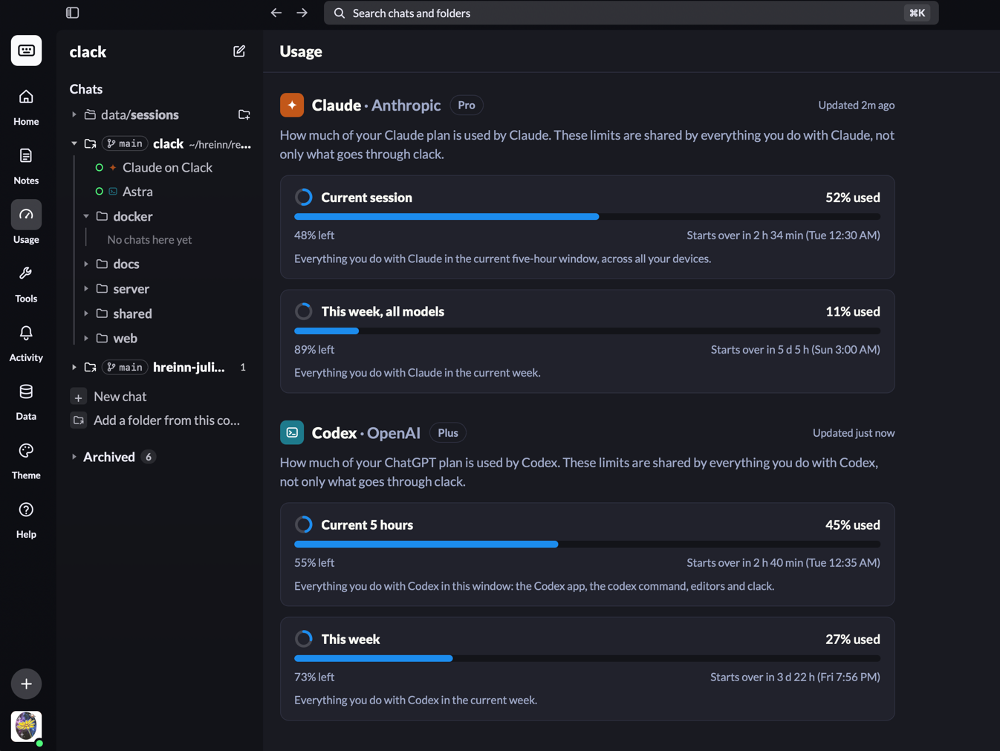

# Usage, tools and the activity log

[← README](../README.md) · [All docs](../README.md#documentation)

## Usage

**Usage** in the rail shows how much of each agent's plan limits is used, one section per
agent with its own sign, plan and time of the last reading. For Claude: the current
five-hour session, the week, and any limits that apply to one model, each with the time
it starts over. These limits cover everything you do with Claude, on any device, not
only what goes through Clack. Extra pay-as-you-go usage is listed too when it is
switched on. With an API key or a cloud provider there are no plan limits, and the page
says so.

For Codex: the windows your ChatGPT plan has (five hours and a week on Plus), with when
each starts over, and prepaid credits when there are any. These cover everything you do
with Codex: the Codex app, the `codex` command, editors and Clack.

In a chat, the small ring beside the send button shows the limit of that chat's agent that
is closest to running out; its card says whose figures they are. It is blue while there is plenty left, turns amber as it runs low and red
near the end. Clicking it lists every limit, and how full the model's context window is
in that chat (known once a turn has finished there).

The figures are read again after every turn in any chat, when Claude Code reports that
a limit has moved, and with **Refresh** on the page. They come from a part of the Agent
SDK that is marked experimental, so a future version may change or remove it; Clack
then shows what it can still read.



## Tools and skills

**Tools** in the rail lists what an agent can use in your chats. With Codex set up, a
**Claude | Codex** switch at the top picks whose: each has its own MCP servers (Codex's
are in `~/.codex/config.toml`, added with `codex mcp add`), skills and built-in tools. For
Claude:

- **MCP servers**, with whether each is connected (or needs signing in, or failed),
  where it is set up (yours, a folder's `.mcp.json`, a claude.ai connector, a plugin),
  and its tools with what they do. Click a server to see its tools.
- **Skills**, every one Claude Code loads, with what each is for and where it comes from
  (built in, yours, a folder's, a plugin's, your Claude account's). Most can also be run
  as `/name`; the ones marked **Claude only** cannot, and Claude uses them on its own.
- **Agents** Claude can hand work to, and **your own slash commands**.
- **Built-in tools** such as Bash, Read and Edit. Claude Code only names these when a
  conversation starts, so the list is the one the most recent chat reported (kept in
  `data/tools.json`), and is empty until a chat has started.

**Everywhere** shows your own setup. Pick a folder to also see what it sets up itself,
such as a `.mcp.json` or skills under `.claude/skills` in it. The filter narrows every
section at once.

The list comes from a short-lived Claude Code process started in that folder, which is
asked and not sent anything, so it costs no tokens. MCP servers connect in the
background, so it takes a few seconds; the answer is kept for five minutes, and
**Refresh** asks again.

## Activity log

Everything that happens in a chat is logged: your prompts, Claude's responses (with the
model that wrote them), tool calls and their results, permission decisions including
requests the server refused on its own, and errors.

- **In the UI:** open **Activity** in the rail, or go to `#/debug/log`. The page shows the
  most recent 1,000 entries, follows new ones as they arrive, and can be filtered by type
  or by text. The folder name on each entry links to that chat.
- **On disk:** `data/logs/clack-YYYY-MM-DD.jsonl`, one JSON object per line. These files
  are the complete record and are never trimmed or deleted by Clack.

```bash
tail -f data/logs/clack-$(date +%F).jsonl
```

Prompts and responses are logged in full. Tool inputs and results are cut to their first
2,000 characters.
